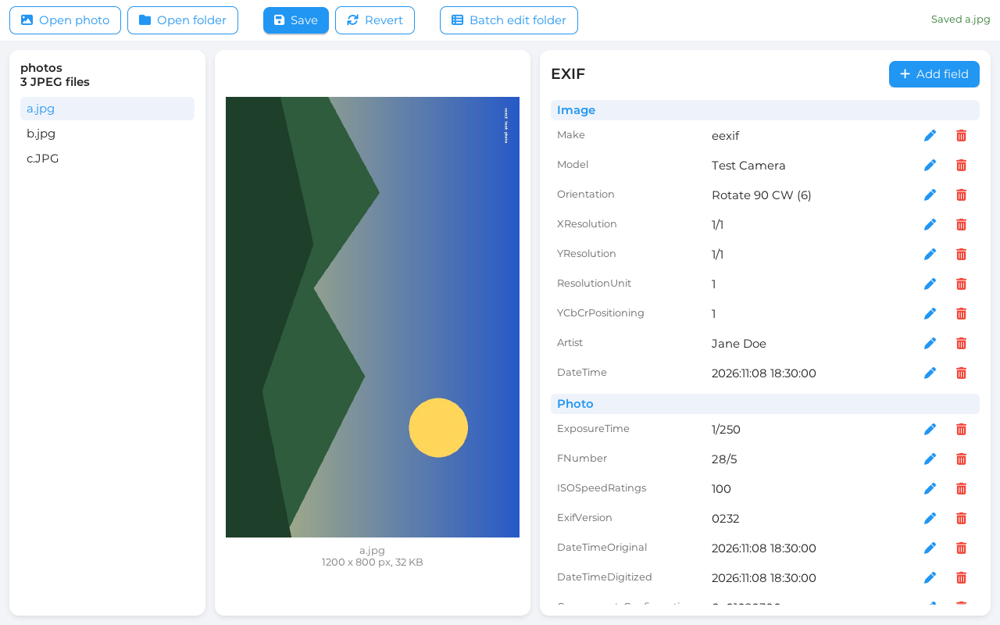
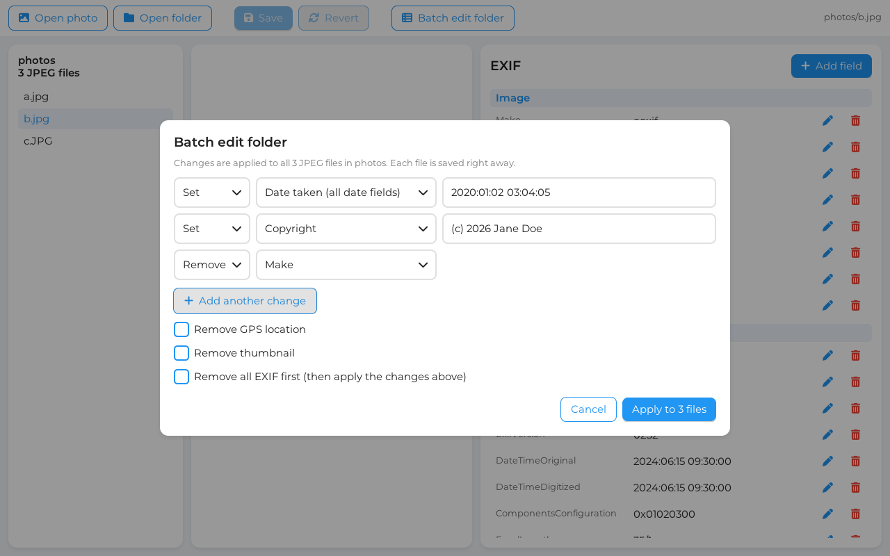

# eexif

A desktop EXIF editor for JPEG photos, written in Zig with LVGL and SDL3.

Open a photo to see its EXIF data, edit any field with the pencil button and
save. Open a folder to step through its photos one by one, or change all of
them at once: set the date taken, add a copyright, remove GPS location, and so on.



## Features

- Shows every EXIF field, grouped as Image, Photo, GPS, Interoperability and Thumbnail
- Edit, add and delete fields; values are checked before they are stored
  (dates, fractions like `1/250`, numbers, text in any language)
- Orientation is picked from a list, and the preview follows it
- **Batch edit folder**: apply several changes to every JPEG in a folder
  - set or remove any field, including "Date taken" (all three date fields at once)
  - remove GPS location, remove thumbnails, or remove all EXIF first
  - every value is validated before any file is touched
- Safe saving: each file is written to a temporary file and then renamed over
  the original, so an interrupted save never leaves a broken photo
- Image data is never re-encoded; only the EXIF segment changes
- Unsaved changes are never lost silently



EXIF reading and writing is done by [wexif](https://github.com/progfargo/wexif).

## Usage

```sh
eexif                 # then use Open photo / Open folder
eexif photo.jpg
eexif ~/Pictures/trip
```

| Key | Action |
|---|---|
| Ctrl+O | Open photo |
| Ctrl+S | Save |
| Ctrl+V | Paste into the text field |
| Enter | Apply the dialog |
| Esc | Close the dialog |

Value formats:

| Field | Example |
|---|---|
| Dates | `2026:11:08 18:30:00`, `2026-11-08T18:30:00+03:00` |
| Time zone (OffsetTime*) | `+03:00` |
| Fractions (ExposureTime, FNumber, ...) | `1/250`, `2.8` |
| Several values | `24/1, 70/1, 14/5, 14/5` |
| Raw bytes | `0x30323332` |

## Building

Requirements:

- Zig 0.17.1
- libjpeg (libjpeg-turbo) development files, for the preview: `sudo apt install libjpeg-turbo8-dev`
- zenity, for the open dialogs: `sudo apt install zenity`

LVGL, SDL3 and wexif are fetched by the Zig build system.

```sh
zig build                          # debug build: zig-out/bin/eexif
zig build -Doptimize=ReleaseSmall  # about 5 MB
zig build run -- ~/Pictures
```

Tested on Linux (X11).

## Tests

```sh
zig build test
```

runs the unit tests of the editing logic (parsing values, batch operations,
saving).

The in-app test drives the real UI without opening a window and checks the
files it writes:

```sh
EEXIF_TEST=1 SDL_VIDEO_DRIVER=offscreen EEXIF_TEST_DIR=/tmp/eexif-test ./zig-out/bin/eexif
```

It prints `test: ok` at the end. Add `EEXIF_SHOT=<dir>` to save screenshots.

## Limitations

- JPEG only
- The MakerNote field is kept as is but cannot be edited
- XMP and IPTC metadata are left untouched

Written with Claude.

## License

MIT. Bundled fonts: Montserrat (SIL Open Font License, `assets/Montserrat-OFL.txt`)
and Font Awesome Free (`assets/FontAwesome-LICENSE.txt`).
